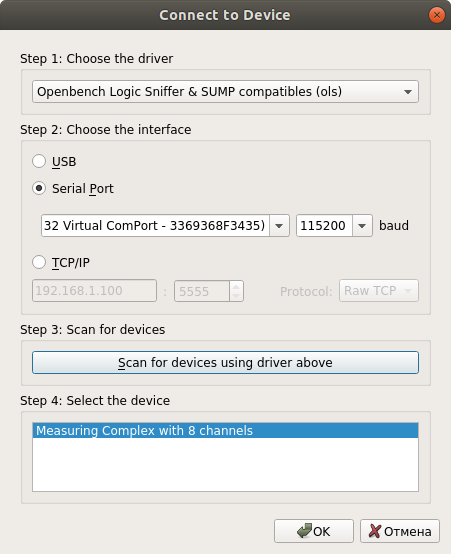
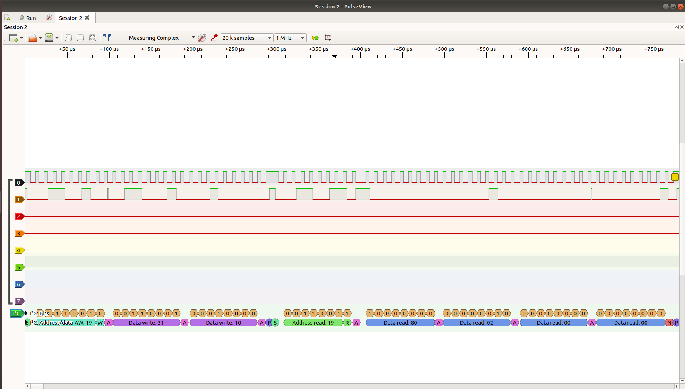

# stm32-sump-analyzer

8-канальный логический анализатор STM32F407 для PulseView.

[](https://github.com/ALLeksandrOrlov/stm32-sump-analyzer/actions/workflows/build.yml)

Основан на [Digital Logic Analyzer STM32F407 for PulseView](https://github.com/AleksandrOrloff/Digital_Logic_Analyzer_STM32F407_for_PulseView).
История исходного проекта сохранена.

Прошивка использует SUMP через USB CDC, захватывает PD0…PD7 через TIM1 + DMA2
и возвращает отсчёты от новых к старым. Код протокола, управление захватом,
прикладная логика и работа с STM32 разделены. RTOS и динамическая память в новых
модулях не используются; библиотека USB ST сохраняет свой штатный allocator.

## Быстрый старт: сборка и тесты в Docker

Требуются GNU make и работающий Docker с Buildx:

```sh
make docker-build
```

Команда готовит контейнер с ARM-компилятором и расширенным QEMU, запускает тесты
и собирает прошивку. ARM toolchain и QEMU на хосте не требуются.

- Проверенные ELF/HEX/BIN/MAP, метаданные и SHA256: `out/ci/dist/`.
- Логи, JUnit и сводка: `out/ci/reports/`.
- `make docker-test` запускает тот же полный сценарий.
- Первая сборка QEMU занимает несколько минут; инструменты кешируются,
  сами тесты выполняются заново при каждом запуске.

GitHub Actions запускает этот же контейнер на PR, push и вручную. По тегам
`vMAJOR.MINOR.PATCH` после проверок публикуются файлы GitHub Release;
`vMAJOR.MINOR.PATCH-rc.1` создаёт prerelease. См. [CI/CD](docs/ci-cd.md)
и [выпуск версии](docs/releases.md).

На macOS Docker использует Linux VM. Управление установленным окружением Lima
описано в [диагностике](docs/troubleshooting.md).

## Локальная сборка

Требуются GNU make и GNU Arm Embedded GCC с newlib. CubeMX и IDE для сборки не нужны.

```sh
make -j4
make test
make test-sanitize
make qemu-test                      # обычный qemu-system-arm
make qemu-stm32-test QEMU=/path/to/patched/qemu-system-arm
```

Прошивка: `out/firmware/meas_complex.{elf,hex,bin,map}`. Компилятор можно указать так:

```sh
make CROSS_COMPILE=/path/to/toolchain/bin/arm-none-eabi-
```

GNU make выбирает `GNUmakefile`. Генерируемый CubeMX `Makefile` оставлен как есть
и не используется новой сборкой. Каталог `build/` содержит исторический бинарник
из исходного проекта; новые артефакты всегда находятся в `out/`.

## Архитектура

| Модуль | Ответственность |
| --- | --- |
| `core/sump_protocol.*` | Потоковый разбор SUMP, ID и метаданные; без HAL и USB |
| `core/capture.*` | Конфигурация, расчёт таймеров, ECA-автомат, порядок отсчётов |
| `core/analyzer_app.*` | Преобразование команд в действия, неблокирующая отправка |
| `platform/stm32/capture_stm32.*` | GPIO, EXTI, TIM1/TIM8, DMA и короткие ISR |
| `platform/stm32/analyzer_board.*` | Сборка компонентов, mailbox USB, основной цикл |
| `Src/`, `Inc/` | CubeMX и точки подключения в секциях USER CODE |
| `qemu/` | Дополнительная модель периферии для QEMU и инструкция сборки |
| `tests/` | Общие тесты ядра и интеграционные тесты STM32-драйвера |

Подробности: [архитектура и контракты](docs/architecture.md),
[сохранность при генерации CubeMX](docs/cubemx.md),
[модель QEMU](qemu/README.md), [проверка на плате](docs/hardware-validation.md),
[результаты выполненных проверок](docs/verification.md).

Для разработки: [CONTRIBUTING](CONTRIBUTING.md),
[оглавление документации](docs/README.md), [CHANGELOG](CHANGELOG.md).

## Возможности и ограничения

- 8 каналов, PD0…PD7, буфер 28 КиБ; запрошенный размер проверяется до DMA.
- Верхняя заявленная частота — 20 МГц. При TIM1=168 МГц максимальная разрешённая
  частота округляется вниз до 18,667 МГц. Фактический устойчивый предел DMA/GPIO
  необходимо измерять на плате.
- Захват без триггера завершается по DMA Transfer Complete.
- Базовый триггер: любой из выбранных фронтов EXTI, как в исходном проекте.
  Это **не** многобитное сравнение уровней и не многоступенчатый триггер SUMP.
- Посттриггерные отсчёты считает TIM8 от обновлений TIM1; остановка выполняется
  в ISR, поэтому положение триггера зависит от задержки прерываний.
- RLE, DDR, внешний clock, фильтр и отключение единственной группы не поддержаны:
  такой RUN переводит контроллер в ERROR до запуска DMA. RESET восстанавливает
  конфигурацию по умолчанию. SUMP не имеет отдельного ответа об ошибке RUN.
- Неизвестные длинные команды потребляются целиком и игнорируются, чтобы не
  нарушать границы следующей команды.

## Подключение к PulseView

1. Прошить новый `.bin` по адресу `0x08000000` или использовать `.elf` со своим
   отладчиком. Конфигурация платы предполагает HSE 8 МГц, SYSCLK 168 МГц.
2. Подключить USB FS и выбрать SUMP-совместимый драйвер и порт USB CDC.
3. Выбрать до 28 672 отсчётов, восемь каналов и поддерживаемые настройки.
4. Сначала проверить захват без триггера, затем одиночный фронт.




Эти изображения сохранены из исходного проекта. QEMU проверяет цифровую модель;
USB/PulseView, точность времени и электрические свойства проверяются на плате.
