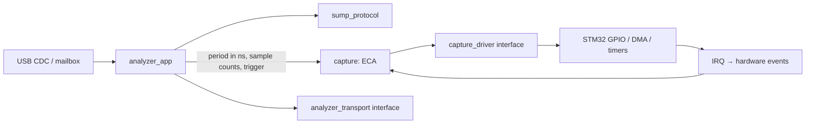

# Архитектура

Зависимости направлены от адаптеров к независимому C11-ядру. В `core/` нет
заголовков STM32, USB, глобальной конфигурации устройства и выделения памяти.
Приложение можно создать несколько раз с разными драйверами и транспортами.

## Протокол

`sump_parser_push` принимает байт и выдаёт команду только после её полного
получения. Команды 0x00…0x7F имеют длину один байт; 0x80…0xFF — пять байтов.
Параметры читаются побайтно в little-endian. Отдельные байты RESET внутри
аргумента длинной команды не трактуются как самостоятельные команды. Пять
нулей, используемых клиентами для ресинхронизации, позволяют выйти из любой
незавершённой команды. USB-пакет может содержать несколько команд или часть одной.
Числа в метаданных выдаются в big-endian, ID устройства — `1ALS`.

## Преобразование команд в параметры захвата

`analyzer_app` переводит команды SUMP в конфигурацию с физическими единицами:

- Из 24-битного делителя получает период `sample_period_ns = (divider + 1) * 10`.
  Единица делителя SUMP соответствует 10 нс.
- Обе половины COUNTS переводит в число отсчётов по формуле `(encoded + 1) * 4`,
  выполняя вычисления в `uint32_t`.
- Хранит все 32 бита FLAGS в `sump_flags` и проверяет их при RUN. Допустимы
  отключение отсутствующих групп каналов и флаг фильтра как подсказка клиента;
  остальные биты отклоняются. Подсказка фильтра не меняет отсчёты GPIO.

Контроллер `capture` получает период, число отсчётов и выбор фронта. Он не знает
команд, делителей, флагов и формата SUMP. Поэтому другой протокол или тест может
использовать тот же контроллер, задавая параметры непосредственно.

## Контроллер захвата: Event–Condition–Action

| Событие | Условие | Действие / новое состояние |
| --- | --- | --- |
| RUN | IDLE, корректные параметры, драйвер стартовал | ARMED с триггером, иначе RUNNING |
| RUN | IDLE, некорректные параметры / ошибка старта | Остановка, ERROR |
| TRIGGER | ARMED | RUNNING |
| COMPLETE | ARMED или RUNNING | SENDING |
| SENT | SENDING, транспорт закончил последнюю порцию | IDLE |
| ERROR | Любое | Остановка, ERROR |
| RESET | Любое | Остановка, IDLE |

События, не разрешённые в текущем состоянии, игнорируются. Повторный RUN во время
захвата или передачи не перезапускает DMA. План захвата копируется в момент RUN;
настройки последующих команд относятся к следующему запуску. COMPLETE допустим
сразу из ARMED: ISR может успеть обработать фронт и завершение между двумя poll.

Конфигурация хранит период в наносекундах и количество отсчётов в `uint32_t`.
Нулевой период, нулевые размеры, размер выше буфера, post > total и выбор
нескольких каналов триггера отклоняются до старта драйвера. Маска триггера
сохраняет все 32 бита входной команды; биты вне существующих каналов 0…7
также приводят к отказу при RUN. Таймерный план
рассчитывается через 64-битную арифметику без промежуточного деления частот.
Если период не помещается в произведение двух 16-битных делителей PSC/ARR,
план отклоняется. Округление периода вверх не позволяет превысить ни запрошенную
частоту, ни заявленный максимум устройства.

## Передача и владение памятью

Драйвер владеет одним буфером 28 КиБ, доступным DMA. Он не меняется между COMPLETE
и следующим RUN. Приложение читает кольцо от последнего записанного байта назад,
порциями до 64 байт. Это ограничивает дополнительную память размером USB-пакета.

Транспорт заимствует `app.tx` до `ready() == true`. Ни новый ID/META, ни RESET не
перезаписывают этот массив во время передачи. Неудачный `write()` не продвигает
смещение. После RESET отменяются ещё не отправленные данные; уже принятый USB
пакет нельзя отозвать этим интерфейсом. Клиент должен отбрасывать хвост старого
захвата после отмены. Запросы ID/META во время выдачи данных ждут её завершения,
чтобы ответы не попадали внутрь потока отсчётов.

## Прерывания и основной цикл

В ISR захвата разрешены только работа с периферией, остановка и публикация
события. В них нет USB, парсера и разворота буфера. DMA EN ожидается с ограничением,
а не бесконечно. Ошибка DMA имеет приоритет над одновременным завершением
посттриггерного счётчика: повреждённый захват не передаётся клиенту.
Приоритет захвата выше USB. Модель одного контроллера предполагает
исключительное владение TIM1/TIM8, DMA2 Stream 5 и линиями EXTI0…7.

USB RX копирует один пакет в почтовый буфер (mailbox) и не перевооружает OUT до его потребления.
Так аппаратный NAK обеспечивает backpressure без переполнения очереди и потери
части команды. Mailbox и флаги передаются между ISR и foreground через короткие
критические секции с восстановлением прежнего PRIMASK. При disconnect/reconnect
приложение сбрасывается в основном цикле. Первый пакет новой сессии сохраняется даже
если он пришёл до обработки уведомления о подключении.

## Границы ответственности

Протокол задаёт формат команды, приложение преобразует и проверяет её параметры,
контроллер проверяет план и допустимость перехода, драйвер управляет периферией.
Обнаруженная ошибка запуска или DMA
переводит контроллер в ERROR; восстановление начинается с RESET. Транспорт
отвечает за завершение передачи, поэтому приложение не предполагает, что
успешный `write()` означает немедленную доставку.

Реализация STM32 поддерживает фронтовой триггер EXTI на одном выбранном канале.
Маски с несколькими или отсутствующими каналами отклоняются при построении плана.
Уровневое сравнение и
многоступенчатый триггер требуют отдельной реализации и проверки всего пути:
команда → план → периферия → результат. Пределы модели и порядок аппаратной
проверки описаны в [методике тестирования](verification.md).
