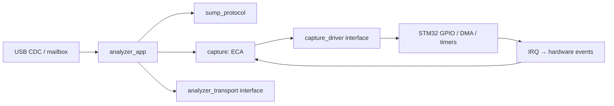

# Архитектура

Зависимости направлены от адаптеров к независимому C11-ядру. В `core/` нет
заголовков STM32, USB, глобальной конфигурации устройства и выделения памяти.
Приложение можно создать несколько раз с разными драйверами и транспортами.

## Протокол

`sump_parser_push` принимает байт и выдаёт команду только после её полного
получения. Команды 0x00…0x7F имеют длину один байт; 0x80…0xFF — пять байтов.
Параметры читаются побайтно в little-endian. Отдельные байты RESET внутри
аргумента длинной команды не трактуются как самостоятельные команды. Пять
нулей, используемых клиентами для ресинхронизации, позволяют выйти из любой
незавершённой команды. USB-пакет может содержать несколько команд или часть одной.
Числа в метаданных выдаются в big-endian, ID остаётся `1ALS`.

## Контроллер захвата: Event–Condition–Action

| Событие | Условие | Действие / новое состояние |
| --- | --- | --- |
| RUN | IDLE, корректные параметры, драйвер стартовал | ARMED с триггером, иначе RUNNING |
| RUN | Некорректные параметры / ошибка старта | Остановка, ERROR |
| TRIGGER | ARMED | RUNNING |
| COMPLETE | ARMED или RUNNING | SENDING |
| SENT | SENDING, транспорт закончил последнюю порцию | IDLE |
| ERROR | Любое | Остановка, ERROR |
| RESET | Любое | Остановка, IDLE |

События, не разрешённые в текущем состоянии, игнорируются. Повторный RUN во время
захвата или передачи не перезапускает DMA. План захвата копируется в момент RUN;
настройки последующих команд относятся к следующему запуску. COMPLETE допустим
сразу из ARMED: ISR может успеть обработать фронт и завершение между двумя poll.

Конфигурация хранит количество отсчётов в `uint32_t`; поля SUMP COUNTS переводятся
как `(encoded + 1) * 4` для обеих половин. Размеры выше буфера и post > total
отклоняются. Период рассчитывается через 64-битную арифметику без промежуточного
деления частот; используются PSC и ARR, поэтому маленькие частоты не переполняют
16-битный ARR. Выбор округления не позволяет превысить ни запрошенную частоту, ни заявленный
максимум устройства.

## Передача и владение памятью

Драйвер владеет одним буфером 28 КиБ, доступным DMA. Он не меняется между COMPLETE
и следующим RUN. Приложение читает кольцо от последнего записанного байта назад,
порциями до 64 байт; отдельного полного перевёрнутого буфера больше нет.

Транспорт заимствует `app.tx` до `ready() == true`. Ни новый ID/META, ни RESET не
перезаписывают этот массив во время передачи. Неудачный `write()` не продвигает
смещение. После RESET отменяются ещё не отправленные данные; уже принятый USB
пакет нельзя отозвать этим интерфейсом. Клиент должен отбрасывать хвост старого
захвата после отмены. Запросы ID/META во время выдачи данных ждут её завершения,
чтобы ответы не попадали внутрь потока отсчётов.

## Прерывания и основной цикл

В ISR захвата разрешены только работа с периферией, остановка и публикация
события. В них нет USB, парсера и разворота буфера. DMA EN ожидается с ограничением,
а не бесконечно. Приоритет захвата выше USB. Модель одного контроллера предполагает
исключительное владение TIM1/TIM8, DMA2 Stream 5 и линиями EXTI0…7.

USB RX копирует один пакет в mailbox и не перевооружает OUT до его потребления.
Так аппаратный NAK обеспечивает backpressure без переполнения очереди и потери
части команды. Mailbox и флаги передаются между ISR и foreground через короткие
критические секции с восстановлением прежнего PRIMASK. При disconnect/reconnect
приложение сбрасывается в foreground. Первый пакет новой сессии сохраняется даже
если он пришёл до обработки уведомления о подключении.

## Изменения относительно исходника

Убраны функции `Start/Stop/Arm` и общие переменные из заголовков `la/`, приведение
невыравненных адресов к `uint32_t *`, бесконечные ожидания USB в ISR, неподтверждённые
16/32-битные режимы при метаданных на восемь каналов. Добавлены обработка USB busy,
проверка размеров, завершение без триггера, обработка ошибок DMA, ограничения
состояний и отдельная сборка. Уровневый и многоступенчатый триггеры не добавлены.
