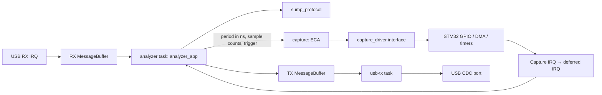

# Архитектура

Зависимости направлены от адаптеров к независимому C11-ядру. В `core/` нет
заголовков STM32, USB, FreeRTOS, глобальной конфигурации устройства и выделения памяти.
Приложение можно создать несколько раз с разными драйверами и транспортами.

## Протокол

`sump_parser_push` принимает байт и выдаёт команду только после её полного
получения. Команды 0x00…0x7F имеют длину один байт; 0x80…0xFF — пять байтов.
Параметры читаются побайтно в little-endian. Отдельные байты RESET внутри
аргумента длинной команды не трактуются как самостоятельные команды. Пять
нулей, используемых клиентами для ресинхронизации, позволяют выйти из любой
незавершённой команды. USB-пакет может содержать несколько команд или часть одной.
Числа в метаданных выдаются в big-endian, ID устройства — `1ALS`.

## Преобразование команд в параметры захвата

`analyzer_app` переводит команды SUMP в конфигурацию с физическими единицами:

- Из 24-битного делителя получает период `sample_period_ns = (divider + 1) * 10`.
  Единица делителя SUMP соответствует 10 нс.
- Обе половины COUNTS переводит в число отсчётов по формуле `(encoded + 1) * 4`,
  выполняя вычисления в `uint32_t`.
- Хранит все 32 бита FLAGS в `sump_flags` и проверяет их при RUN. Допустимы
  отключение отсутствующих групп каналов и флаг фильтра как подсказка клиента;
  остальные биты отклоняются. Подсказка фильтра не меняет отсчёты GPIO.

Контроллер `capture` получает период, число отсчётов и выбор фронта. Он не знает
команд, делителей, флагов и формата SUMP. Поэтому другой протокол или тест может
использовать тот же контроллер, задавая параметры непосредственно.

## Контроллер захвата: Event–Condition–Action

| Событие | Условие | Действие / новое состояние |
| --- | --- | --- |
| RUN | IDLE, корректные параметры, драйвер стартовал | ARMED с триггером, иначе RUNNING |
| RUN | IDLE, некорректные параметры / ошибка старта | Остановка, ERROR |
| TRIGGER | ARMED | RUNNING |
| COMPLETE | ARMED или RUNNING | SENDING |
| SENT | SENDING, транспорт закончил последнюю порцию | IDLE |
| ERROR | Любое | Остановка, ERROR |
| RESET | Любое | Остановка, IDLE |

События, не разрешённые в текущем состоянии, игнорируются. Повторный RUN во время
захвата или передачи не перезапускает DMA. План захвата копируется в момент RUN;
настройки последующих команд относятся к следующему запуску. COMPLETE допустим
сразу из ARMED: ISR может успеть обработать фронт и завершение между двумя poll.
Если последний пакет уже завершён, следующий RUN принимается даже до очередного
poll: приложение проверяет `idle()` перед обработкой нового запуска.

Конфигурация хранит период в наносекундах и количество отсчётов в `uint32_t`.
Нулевой период, нулевые размеры, размер выше буфера, post > total и выбор
нескольких каналов триггера отклоняются до старта драйвера. Маска триггера
сохраняет все 32 бита входной команды; биты вне существующих каналов 0…7
также приводят к отказу при RUN. Таймерный план
рассчитывается через 64-битную арифметику без промежуточного деления частот.
Если период не помещается в произведение двух 16-битных делителей PSC/ARR,
план отклоняется. Округление периода вверх не позволяет превысить ни запрошенную
частоту, ни заявленный максимум устройства.

## Передача и владение памятью

Драйвер владеет одним буфером 112 КиБ, доступным DMA: 28 672 отсчёта по 32 бита.
Регистр GPIO IDR читается словами, как требует RM0090 §8.4.5. После остановки DMA
драйвер в контексте задачи один раз упаковывает младшие восемь бит каждого слова
в начало того же буфера; дополнительная память не выделяется. Упаковка сохраняет
индексы кольца и выполняется до возврата события COMPLETE. Готовые 28 КиБ не
меняются до следующего RUN. Приложение читает кольцо от последнего записанного байта назад,
порциями до 64 байт. Один вызов `analyzer_app_poll()` ставит в очередь не больше
одного пакета.

Контракт `analyzer_transport_t` отделяет приложение от способа передачи:

- `write()` не ждёт USB и копирует весь пакет до возврата `true`.
  При `false` не принято ни одного байта; приложение сохраняет позицию для повтора.
- `idle()` возвращает `true`, когда нет ни пакетов в очереди, ни активной передачи.
  `samples_sent` считает принятые байты, а переход SENDING → IDLE дополнительно
  требует полного завершения транспорта.
- `cancel()` делает пакеты в очереди недействительными. Уже активный пакет может
  завершиться; транспорт обязан сохранить его память до освобождения USB.

Приложение может сразу переиспользовать `app.tx` после успешного `write()`.
Задача TX читает сообщение из MessageBuffer в собственный устойчивый буфер
и передаёт его USB CDC. Только этот буфер заимствуется USB; задача не меняет его
до завершения, включая завершающий пакет нулевой длины (ZLP).

RESET останавливает захват, сбрасывает парсер и конфигурацию, отменяет ожидающий
ответ и очередь вывода. Клиент должен отбросить хвост уже начатого пакета старого
захвата. Запросы ID/META во время выдачи отсчётов ждут полного завершения захвата,
чтобы служебный ответ не попал внутрь данных.

## Задачи и очереди FreeRTOS

| Задача | Приоритет | Стек, 32-битных слов | Ответственность |
| --- | --- | --- | --- |
| `analyzer` | 2 | 768 | Парсер, команды, конфигурация, контроллер захвата, подготовка выходных пакетов |
| `usb-tx` | 3 | 512 | Получение TX-сообщений, отправка USB, ожидание завершения и освобождение памяти |
| Idle | 0 | 256 | Служебная задача ядра |

Задачи, стеки, управляющие структуры и MessageBuffer создаются статически.
Динамическое выделение памяти FreeRTOS отключено. Это не распространяется
на библиотеку USB ST, выделяющую состояние CDC при инициализации класса.
Используется неизменённый [FreeRTOS Kernel V11.3.1](../third_party/FreeRTOS-Kernel/README.md)
с портом GCC ARM_CM4F; контрольные суммы выбранных исходников проверяются в CI.

RX MessageBuffer имеет одного отправителя — USB IRQ — и одного получателя —
задачу приложения. У TX MessageBuffer отправитель — задача приложения,
получатель — задача TX. Каждый буфер вмещает четыре полных пакета по 64 байта
вместе со служебными полями; коротких сообщений может поместиться больше.
Задача TX дополнительно удерживает один пакет вне очереди.

OUT перевооружается только при наличии места под целый максимальный пакет.
Если места нет, USB отвечает NAK; уже принятые байты команды не теряются. Парсер получает непрерывный поток, независимо от
границ USB-пакетов. Пока служебный ответ не принят TX-очередью, приложение
не потребляет следующий байт команды.

Задачи спят на уведомлениях, когда не могут продвинуться. При отказе USB принять
пакет задача TX повторяет попытку через один tick, не выполняя активное ожидание.
Оповещения используют индекс 1; индекс 0 зарезервирован механизмом MessageBuffer.
Событие между проверкой состояния и блокировкой сохраняется в счётчике уведомления.
Когда все рабочие задачи заблокированы, Idle hook выполняет WFI до прерывания.

## Подключение, отмена и ошибки RX

Сообщения несут номера сессии и поколения. Отмена увеличивает поколение TX;
задача TX сама удаляет недействительные сообщения. Живые MessageBuffer никогда
не сбрасываются из чужой задачи или ISR, поэтому сохраняется правило одного
отправителя и одного получателя.

При отключении, переподключении или повреждённом RX-пакете приложение получает
новую сессию, сбрасывает парсер и игнорирует сообщения предыдущей сессии.
Первый пакет нового подключения сохраняется, даже если пришёл до обработки
уведомления задачей приложения.

Физическое подключение имеет отдельный счётчик. Только закрытие endpoint при
отключении или нормальное завершение передачи освобождает заимствованную USB
память. Некорректная длина RX сбрасывает протокол, но не освобождает активный
TX-буфер и не считается физическим отключением. Пакет нулевой длины допустим.

## Прерывания и запуск

В ISR захвата разрешены только работа с периферией, остановка и публикация
события. В них нет USB, парсера и разворота буфера. DMA EN ожидается с ограничением,
а не бесконечно. Ошибка DMA имеет приоритет над одновременным завершением
посттриггерного счётчика: повреждённый захват не передаётся клиенту.
Модель одного контроллера предполагает исключительное владение TIM1/TIM8,
DMA2 Stream 5 и линиями EXTI0…7.

| Прерывание | Числовой приоритет NVIC | Работа с FreeRTOS |
| --- | --- | --- |
| EXTI, DMA2 Stream 5, TIM8 | 1 | Не вызывает API ядра; выставляет событие и pending для отложенного IRQ |
| TIM6_DAC, программное уведомление о захвате | 5 | Уведомляет задачу приложения через FromISR |
| OTG_FS | 6 | Копирует RX и уведомляет задачи через FromISR |
| SysTick / PendSV | 15 | Tick и переключение контекста ядра |

Меньшее число NVIC означает более высокий приоритет. Порог системных вызовов — 5.
Критические секции FreeRTOS используют BASEPRI: они исключают USB и отложенное
уведомление, оставляя IRQ захвата доступными. TIM6_DAC используется как программное
прерывание и не должен назначаться другому периферийному модулю. Модуль
`platform/stm32/capture_task_events` связывает эти уровни: ISR захвата только
выставляет pending TIM6_DAC, а его обработчик уведомляет задачу. Сам таймер TIM6
не запускается. Плата подключает этот переходник после создания задач и до захвата.

Порядок запуска сохраняет работоспособность HAL и ограничения ядра:

1. Плата подготавливает драйверы, статические очереди и задачи.
2. После создания задач восстанавливается исходный BASEPRI, чтобы SysTick HAL
   продолжал работать во время задержек аппаратной инициализации USB.
3. MSP задаёт OTG_FS приоритет 6 и оставляет USB IRQ выключенным. Накопленное
   событие подключения не должно вызвать FreeRTOS API до запуска планировщика.
4. `vTaskStartScheduler()` запускает задачи; первым действием задача TX вызывает
   `activate()` и включает подготовленный USB IRQ.

SVC и PendSV принадлежат порту FreeRTOS. SysTick вызывает HAL и передаёт tick ядру
только после старта планировщика. Точки подключения остаются внутри USER CODE;
подробности приведены в [правилах CubeMX](cubemx.md).

## Границы ответственности

Протокол задаёт формат команды, приложение преобразует и проверяет её параметры,
контроллер проверяет план и допустимость перехода, драйвер управляет периферией.
Обнаруженная ошибка запуска или DMA
переводит контроллер в ERROR; восстановление начинается с RESET. Транспорт
отвечает за завершение передачи, поэтому приложение не предполагает, что
успешный `write()` означает немедленную доставку.

Реализация STM32 поддерживает фронтовой триггер EXTI на одном выбранном канале.
Маски с несколькими или отсутствующими каналами отклоняются при построении плана.
Уровневое сравнение и
многоступенчатый триггер требуют отдельной реализации и проверки всего пути:
команда → план → периферия → результат. Пределы модели и порядок аппаратной
проверки описаны в [методике тестирования](verification.md).
