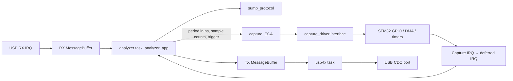

# Architecture

Dependencies point from platform adapters toward a standalone C11 core. The
`core/` directory has no STM32, USB or FreeRTOS headers, global device
configuration, or dynamic memory allocation. Multiple application instances can
use different drivers and transports.

## Protocol

`sump_parser_push` accepts one byte and emits a command only when the entire
command has arrived. Commands `0x00`–`0x7F` are one byte long; commands
`0x80`–`0xFF` are five bytes long. Parameters are decoded byte by byte in
little-endian order. A RESET byte inside a long command's argument is treated as
data. The five zero bytes that clients use for resynchronization finish any
partial command and reset the parser. A USB packet may contain several commands
or only part of one. Numeric metadata uses big-endian encoding; the device ID is
`1ALS`.

## Converting commands into capture settings

`analyzer_app` converts SUMP commands into a configuration with physical units:

- The 24-bit divider becomes `sample_period_ns = (divider + 1) * 10`. Each SUMP
  divider unit represents 10 ns.
- Each half of COUNTS becomes a sample count using `(encoded + 1) * 4`, with
  arithmetic performed in `uint32_t`.
- All 32 FLAGS bits are retained in `sump_flags` and validated on RUN. Disabling
  absent channel groups and setting the filter hint are accepted; other bits
  are rejected. The filter hint does not change GPIO samples.

The `capture` controller receives a period, sample counts and a trigger edge.
It has no knowledge of SUMP commands, dividers, flags or encoding. Another
protocol or a test can use the same controller by supplying these parameters
directly.

## Capture controller: Event–Condition–Action

| Event | Condition | Action / next state |
| --- | --- | --- |
| RUN | IDLE, valid settings, driver started | ARMED with a trigger; otherwise RUNNING |
| RUN | IDLE, invalid settings or driver start failure | Stop, ERROR |
| TRIGGER | ARMED | RUNNING |
| COMPLETE | ARMED or RUNNING | SENDING |
| SENT | SENDING, transport finished the last packet | IDLE |
| ERROR | Any state | Stop, ERROR |
| RESET | Any state | Stop, IDLE |

Events that are not allowed in the current state are ignored. A repeated RUN
during capture or transmission does not restart DMA. The capture plan is copied
on RUN; subsequent configuration commands apply to the next capture. COMPLETE
is allowed directly from ARMED because an ISR may process both the trigger and
completion between two polls. Once the final packet has completed, the next RUN
is accepted even before another poll: the application checks `idle()` before
handling the new request.

The configuration stores the period in nanoseconds and sample counts in
`uint32_t`. A zero period, zero counts, a count larger than the buffer, post-trigger
count greater than total count, or multiple trigger channels are rejected before
the driver starts. The trigger mask retains all 32 bits of the incoming command;
bits outside channels 0–7 also cause RUN to fail. The timer plan uses 64-bit
arithmetic without intermediate frequency division. A period that cannot fit
the product of the two 16-bit PSC/ARR divisors is rejected. Rounding the period
up ensures the actual rate exceeds neither the requested rate nor the device's
advertised maximum.

## Transmission and memory ownership

The driver owns a single 112 KiB buffer accessible by DMA: 28,672 samples stored
as 32-bit words. GPIO IDR is read using word accesses, as required by RM0090
§8.4.5. After DMA stops, the driver runs once in task context to pack the low
eight bits of each word into the start of the same buffer. No additional memory
is allocated. Packing preserves ring indices and finishes before the driver
returns COMPLETE. The resulting 28 KiB of sample data stays unchanged until the
next RUN. The application reads the ring backward from the last recorded byte
in packets of up to 64 bytes. Each `analyzer_app_poll()` call queues at most one
packet.

The `analyzer_transport_t` contract separates the application from the transport:

- `write()` does not wait for USB. It copies the entire packet before returning
  `true`. A `false` result means no bytes were accepted; the application retains
  its position for a retry.
- `idle()` returns `true` when there are no queued packets or active transfers.
  `samples_sent` counts accepted bytes; the SENDING → IDLE transition also
  requires the transport to finish transmitting them.
- `cancel()` invalidates queued packets. An active packet may still complete;
  the transport must retain its memory until USB releases it.

The application may reuse `app.tx` immediately after a successful `write()`. The
TX task receives a MessageBuffer message into its own persistent packet buffer
and submits that buffer to USB CDC. USB borrows only this buffer. The task does
not modify it until transmission completes, including any final zero-length
packet (ZLP).

RESET stops capture, resets the parser and configuration, cancels a pending
reply, and invalidates queued output. The client must discard any remaining
bytes from an already active packet of the previous capture. ID/META requests
received while samples are being sent wait for the capture transfer to finish,
so a command reply cannot appear inside sample data.

## FreeRTOS tasks and queues

| Task | Priority | Stack, 32-bit words | Responsibility |
| --- | --- | --- | --- |
| `analyzer` | 2 | 768 | Parser, commands, configuration, capture controller and output packet preparation |
| `usb-tx` | 3 | 512 | Receive TX messages, submit them to USB, wait for completion and release memory |
| Idle | 0 | 256 | Kernel idle task |

Tasks, stacks, control structures and MessageBuffers are allocated statically.
FreeRTOS dynamic allocation is disabled. This does not apply to the ST USB
library, which allocates CDC state during class initialization. The project uses
the unmodified [FreeRTOS Kernel V11.3.1](../third_party/FreeRTOS-Kernel/README.md)
with the GCC ARM_CM4F port; CI verifies checksums of the selected source files.

The RX MessageBuffer has one producer, the USB IRQ, and one consumer, the
application task. The TX MessageBuffer has the application task as its producer
and the TX task as its consumer. Each buffer holds four full 64-byte packets
with their message headers; more short messages may fit. The TX task also holds
one packet outside the queue.

The OUT endpoint is rearmed only when there is room for an entire maximum-sized
packet. If there is no room, USB responds with NAK, preserving command bytes
already accepted. The parser receives a continuous stream regardless of USB
packet boundaries. Until the TX queue accepts a command reply, the application
does not consume the next command byte.

Tasks block on notifications when they cannot make progress. If USB refuses a
packet, the TX task retries after one tick without busy-waiting. Notifications
use index 1; MessageBuffer reserves index 0. An event arriving between the state
check and the wait is retained in the notification counter. When all worker tasks
are blocked, the Idle hook executes WFI until an interrupt arrives.

## Connection changes, cancellation and RX errors

Messages carry session and generation numbers. Cancellation increments the TX
generation; the TX task discards invalid messages itself. A live MessageBuffer
is never reset from another task or an ISR, preserving its single-producer,
single-consumer ownership.

A disconnect, reconnect or malformed RX packet starts a new application session.
The application resets its parser and ignores messages from the previous
session. The first packet of a new connection is retained even if it arrives
before the application task handles the notification.

Physical connections have a separate counter. Only endpoint closure during
disconnect or normal transfer completion releases memory borrowed by USB. An
invalid RX length resets the protocol but does not release the active TX buffer
or count as a physical disconnect. A zero-length packet is valid.

## Interrupts and startup

Capture ISRs may only access peripherals, stop capture and publish events. They
do not access USB, parse commands or reverse the sample buffer. Waiting for DMA
EN to clear is bounded. A DMA error takes precedence over simultaneous completion
of the post-trigger counter, so a damaged capture is not sent to the client. The
single-controller design assumes exclusive ownership of TIM1/TIM8, DMA2 Stream 5
and EXTI lines 0–7.

| Interrupt | Numeric NVIC priority | FreeRTOS interaction |
| --- | --- | --- |
| EXTI, DMA2 Stream 5, TIM8 | 1 | No kernel API calls; publish an event and pend the deferred IRQ |
| TIM6_DAC, software capture notification | 5 | Notify the application task through FromISR |
| OTG_FS | 6 | Copy RX data and notify tasks through FromISR |
| SysTick / PendSV | 15 | Kernel tick and context switching |

A lower NVIC number means higher priority. The system-call priority threshold
is 5. FreeRTOS critical sections use BASEPRI to mask USB and deferred
notifications while keeping capture IRQs available. TIM6_DAC is used as a
software interrupt and must not be assigned to another peripheral. The
`platform/stm32/capture_task_events` module connects these priority levels:
capture ISRs only pend TIM6_DAC, whose handler notifies the task. Timer TIM6
itself is not started. Board initialization connects this adapter after task
creation and before capture begins.

Startup preserves HAL timing and the kernel's interrupt requirements:

1. The board initializes drivers, static queues and tasks.
2. After task creation, the original BASEPRI is restored so the HAL SysTick keeps
   running during USB hardware initialization delays.
3. MSP sets OTG_FS to priority 6 and leaves the USB IRQ disabled. A pending
   connection event must not invoke FreeRTOS APIs before the scheduler starts.
4. `vTaskStartScheduler()` starts the tasks. The TX task first calls `activate()`
   to enable the prepared USB IRQ.

SVC and PendSV belong to the FreeRTOS port. SysTick services HAL and forwards the
tick to the kernel only after the scheduler starts. Integration points remain
inside USER CODE sections; see the [CubeMX rules](cubemx.md).

## Module responsibilities

The protocol defines command encoding. The application converts and validates
command parameters. The controller checks the capture plan and state
transitions. The driver controls peripherals. A startup or DMA error moves the
controller to ERROR; recovery begins with RESET. The transport owns completion,
so the application does not assume that a successful `write()` means immediate
delivery.

The STM32 implementation supports an EXTI edge trigger on one selected channel.
Masks selecting multiple channels or unavailable channels are rejected when the
plan is built. Level comparison and multistage triggers require their own
implementation and validation of the entire path: command → plan → peripheral →
result. Model limitations and hardware checks are described in the
[verification guide](verification.md).
