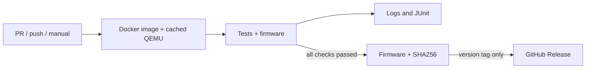

# CI/CD

## Один сценарий для компьютера и GitHub Actions

```sh
make docker-build
```

Команда собирает образ `stm32-sump-analyzer-ci:local` (Dockerfile target `ci`) и запускает
`scripts/ci.py` в отдельном контейнере с исходниками проекта. Компилятор ARM,
санитайзеры, обычный QEMU и QEMU с моделью анализатора находятся внутри образа.
Ничего из этого не требуется устанавливать на хост. `make docker-test` — псевдоним
того же полного сценария, включая проверку сборки прошивки.

После сборки образа контейнер тестов работает с отключённой сетью.
Тесты выполняются при каждом запуске контейнера. Кеш Docker ускоряет подготовку
инструментов и сборку QEMU, но не подменяет выполнение тестов старым слоем `RUN`.

Последовательность:

1. Самопроверка CI: ошибки, таймауты, запрет публикации при провале и SHA256.
2. Проверка секций CubeMX.
3. Нативные тесты протокола, ECA, прикладной логики и USB mailbox.
4. Те же тесты под AddressSanitizer и UndefinedBehaviorSanitizer.
5. Переносимое ядро на Cortex-M4 в обычном QEMU.
6. Настоящий STM32-драйвер на расширенной модели QEMU.
7. Сборка прошивки и упаковка результатов, если **все** проверки прошли.

QEMU использует программную эмуляцию TCG; KVM, вложенная виртуализация,
`--privileged` и доступ к USB для тестов не нужны. Запуск QEMU ограничен таймаутом.
Выход с нулевым кодом без ожидаемого сообщения теста не считается успехом.

## Выходные файлы

```text
out/ci/
├── dist/
│   ├── stm32_sump_analyzer.bin
│   ├── stm32_sump_analyzer.hex
│   ├── stm32_sump_analyzer.elf
│   ├── stm32_sump_analyzer.map
│   ├── build-info.json
│   └── SHA256SUMS
├── reports/
│   ├── junit.xml
│   ├── results.json
│   ├── summary.md
│   └── *.log
└── work/                  # промежуточные объекты и тестовые ELF
```

Перед каждым запуском очищается только выбранный каталог результатов внутри
`out/`; старый успешный результат не может выдаваться за результат нового запуска.
При ошибке оставшиеся этапы также выполняются для диагностики. Итоговый код
завершения ненулевой, отчёты сохраняются, `dist/` не создаётся. JUnit содержит
результаты этапов сценария, а не отдельный XML testcase для каждого C assert.

`build-info.json` содержит исходный commit/ref, признак локальных изменений и
версии ARM-компилятора/QEMU. При локальной сборке незакоммиченного рефакторинга
`source_dirty` будет `true`. `SHA256SUMS` покрывает прошивку и метаданные.

## GitHub Actions



Workflow: `.github/workflows/build.yml`.

- PR и push в любую ветку: сборка образа, все проверки, артефакты.
- Ручной `workflow_dispatch`: тот же сценарий без публикации Release.
- Push тега `vMAJOR.MINOR.PATCH` или `vMAJOR.MINOR.PATCH-suffix`: проверки,
  затем отдельный release job с публикацией **тех же** проверенных файлов.
- Теги с суффиксом, например `v0.1.0-rc.1`, создают prerelease.

Для окружения используется `ubuntu-24.04`. Длительность build/test ограничена
40 минутами; release — 10 минутами. Новый push отменяет устаревший запуск ветки,
но запуск по тегу не отменяется. Отчёты сохраняются даже при провале тестов,
прошивка — только после успеха; срок хранения artifacts — 30 дней.
Если упала сама сборка Docker-образа, тестовые отчёты ещё не существуют: диагностика
находится в логе шага Build the CI environment.

Токен build job имеет только `contents: read`, checkout не сохраняет credentials.
Право `contents: write` есть только у release job. Сторонних release-токенов и
секретов не требуется. Actions закреплены на SHA, а QEMU — на версии и commit.
Dependabot еженедельно предлагает обновления Actions и базового Docker-образа.
Кеш BuildKit хранится через GitHub Actions Cache. Базовый Debian-образ закреплён
на digest; apt-пакеты пока берутся из текущего bookworm, поэтому побитовая
воспроизводимость между датами не обещается.

## Отдельные команды

```sh
# Только собрать образ инструментов
docker buildx build --target ci --load -t stm32-sump-analyzer-ci:local .

# Повторить весь сценарий без пересборки образа
docker run --rm --network=none --user "$(id -u):$(id -g)" \
  --mount "type=bind,src=$PWD,dst=/project" \
  stm32-sump-analyzer-ci:local

# Запустить только аппаратные тесты QEMU для отладки
docker run --rm --network=none --user "$(id -u):$(id -g)" \
  --mount "type=bind,src=$PWD,dst=/project" \
  stm32-sump-analyzer-ci:local make qemu-stm32-test QEMU=qemu-system-arm-sump-analyzer
```

При прямом `docker run` без переменных `SOURCE_*` происхождение сборки в метаданных
будет `unknown`. Для выпуска используйте `make docker-build` или workflow.
Отдельные тестовые команды помогают диагностике и не заменяют полный release gate.

Альтернативный BuildKit export без bind mount:

```sh
docker buildx build --target artifacts \
  --output type=local,dest=out/export .
```

Результат: `out/export/firmware/` и `out/export/reports/`. Это вспомогательный
экспорт: при неуспешном `RUN` BuildKit не экспортирует файлы отчётов. Для разработки
и CI предпочтителен основной запуск контейнера.
