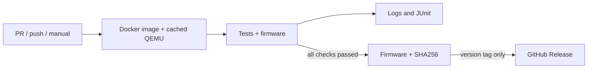

# CI/CD

## Run the same pipeline locally and in GitHub Actions

```sh
make docker-build
```

This builds the `stm32-sump-analyzer-ci:local` image from the Dockerfile's `ci`
target, then runs `scripts/ci.py` in a container with the project directory
mounted. The image includes the ARM compiler, sanitizers, stock QEMU and QEMU
with the analyzer's peripheral model. These tools do not need to be installed
on the host. `make docker-test` runs the same complete pipeline, including the
firmware build.

After the image has been built, the test container runs with networking disabled.
Every container run executes the tests. Docker caches the tools and QEMU build;
test execution is independent of that cache.

The pipeline runs nine stages:

1. Python tests for the pipeline, timeouts, publication safeguards, QEMU overlay
   installer, pinned FreeRTOS source checksums, hardware smoke-test utility and
   USB VBUS integration.
2. CubeMX `USER CODE` boundary checks.
3. Native tests for the protocol, capture state machine, application and USB CDC
   adapter; compilation of the PulseView test fixture.
4. The same native tests with AddressSanitizer and UndefinedBehaviorSanitizer.
5. Coverage measurement for the core and USB adapter, requiring at least 95%
   line coverage and 90% branch coverage.
6. Portable core tests on Cortex-M4 in stock QEMU.
7. The STM32 capture driver on the extended QEMU model.
8. Application and transmit tasks using the actual FreeRTOS kernel and message
   buffers on Cortex-M4F: IRQ startup, backpressure, cancellation, reconnection
   and TX completion. A second ELF tests their integration with the capture
   driver and deferred IRQ bridge.
9. Firmware compilation. Release files are packaged only when **all** stages pass.

The three QEMU stages run four test ELF files. RTOS tests replace physical USB
with a test port that controls interrupts and transfer completion. Native
coverage includes `core/` and `platform/stm32/usb_cdc_port.c`; it excludes the
scheduler and message-buffer implementation.

QEMU uses TCG software emulation. Tests need neither KVM, nested virtualization,
`--privileged`, nor USB access. Each QEMU run has a timeout. A zero exit code
without the expected test success message is treated as a failure.

## Output files

```text
out/ci/
├── dist/
│   ├── stm32_sump_analyzer.bin
│   ├── stm32_sump_analyzer.hex
│   ├── stm32_sump_analyzer.elf
│   ├── stm32_sump_analyzer.map
│   ├── build-info.json
│   └── SHA256SUMS
├── reports/
│   ├── junit.xml
│   ├── results.json
│   ├── summary.md
│   ├── coverage/          # Native coverage in HTML, XML and JSON
│   └── *.log
└── work/                  # Intermediate objects and test ELF files
```

Each run clears its selected output directory under `out/`, preventing old
results from being mistaken for a new successful build. After a failure, the
remaining stages still run to collect diagnostics. The pipeline exits with a
nonzero status, preserves reports and does not create `dist/`. JUnit records
pipeline stages, rather than one XML test case per C assertion. See
[verification](verification.md) for test selection and coverage boundaries.

`build-info.json` records the source commit and ref, whether the checkout has
local changes, and the ARM compiler and QEMU versions. A local build with
uncommitted changes records `source_dirty` as `"true"`. `SHA256SUMS` covers the
firmware files and build metadata.

## GitHub Actions



Workflow: [`.github/workflows/build.yml`](../.github/workflows/build.yml).

- Pull requests and pushes to any branch build the image, run every check and
  upload artifacts.
- Manual `workflow_dispatch` runs use the same pipeline without publishing a release.
- A push of `vMAJOR.MINOR.PATCH` or `vMAJOR.MINOR.PATCH-suffix` runs the checks,
  then a separate release job publishes the files produced by that run.
- A suffix such as `v0.1.0-rc.1` marks the GitHub Release as a prerelease.

Jobs use `ubuntu-24.04`. Build and test jobs have a 40-minute limit; the release
job has a 10-minute limit. A new push cancels an older run for the same branch;
tag runs are not cancelled this way. Reports are uploaded even if tests fail.
Firmware artifacts are uploaded only after success. Artifact retention is
30 days. If the Docker image itself fails to build, test reports do not yet
exist; inspect the **Build the CI environment with patched QEMU** step instead.

The build job has only `contents: read`, and checkout does not preserve
credentials. Only the release job has `contents: write`. It uses the standard
`GITHUB_TOKEN`; no separate release token or secret is required. Actions are
pinned to commit hashes, and QEMU is pinned to a version and commit. The
FreeRTOS V11.3.1 subset is vendored in `third_party/FreeRTOS-Kernel/`; its SHA256
manifest is checked offline.

Dependabot proposes weekly updates to Actions and the Docker base image.
BuildKit uses the GitHub Actions cache. The Debian base image is pinned by
digest, but apt packages are taken from the current bookworm repositories, so
builds from different dates are not guaranteed to be bit-for-bit identical.

## Run individual commands

The developer workflow uses Git and GNU Make on the host. The [quick
start](../README.md) provides a source ZIP and a direct Docker command for users
who only need to build and flash the firmware.

Run these commands from the repository root:

```sh
# Build the tool image only.
docker buildx build --target ci --load -t stm32-sump-analyzer-ci:local .

# Repeat the full pipeline without rebuilding the image.
docker run --rm --network=none --user "$(id -u):$(id -g)" \
  --mount "type=bind,src=$PWD,dst=/project" \
  stm32-sump-analyzer-ci:local

# Run the STM32 peripheral tests in QEMU.
docker run --rm --network=none --user "$(id -u):$(id -g)" \
  --mount "type=bind,src=$PWD,dst=/project" \
  stm32-sump-analyzer-ci:local make qemu-stm32-test QEMU=qemu-system-arm-sump-analyzer

# Run the FreeRTOS USB tests and their integration with the capture driver.
docker run --rm --network=none --user "$(id -u):$(id -g)" \
  --mount "type=bind,src=$PWD,dst=/project" \
  stm32-sump-analyzer-ci:local make qemu-rtos-test QEMU=qemu-system-arm-sump-analyzer
```

A direct `docker run` without `SOURCE_*` variables records the source provenance
as `unknown`. Use `make docker-build` or the GitHub workflow for release builds.
Individual test commands help diagnose failures; a release still requires the
complete pipeline.

## Standalone artifact export

The quick start uses BuildKit to export files without a bind mount or host
development tools:

```sh
docker build --target artifacts --output type=local,dest=out/docker .
```

This creates `out/docker/firmware/` and `out/docker/reports/`. The Dockerfile
runs the same pipeline before exporting files, but BuildKit may reuse that
successful build layer when its inputs have not changed. If a Docker `RUN`
step fails, BuildKit does not export its reports.

Use the normal container pipeline for recurring development and CI checks:
it executes the tests on every run and preserves failure reports. A standalone
export without `SOURCE_*` build arguments records source provenance as
`unknown`, which is suitable for a local quick-start build but does not satisfy
the release job's provenance checks.
