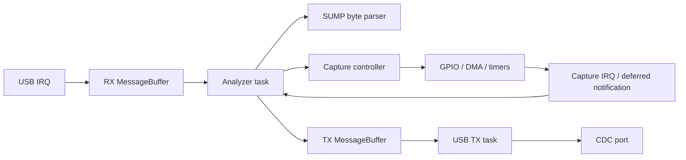

# Development

The [quick start](../README.md) covers building, flashing and using PulseView.
This guide covers the eight-channel SUMP analyzer on STM32F407 with USB CDC.

## Architecture



| Module | Responsibility |
| --- | --- |
| `core/sump_protocol` | Incremental command framing, identity and metadata |
| `core/capture_plan` | Validate physical settings and calculate timer divisors |
| `core/capture` | Event-condition-action state machine and sample access |
| `core/analyzer_app` | Convert commands to capture settings and prepare replies |
| `platform/freertos` | Static tasks, message ownership and USB session handling |
| `platform/stm32` | Register drivers, CDC adapter, static USB storage and board wiring |

The core has no HAL or RTOS dependencies. Its application API has one task owner.
Public headers document buffer lifetime, execution context and failure behavior
with Doxygen comments. A software module does not imply a separate task.

USB RX interrupts copy at most one 64-byte packet and notify a task. Commands are
assembled across packet boundaries in the analyzer task. The separate TX task
owns the buffer borrowed by USB until completion, including a terminating ZLP.
When RX storage is full, the endpoint remains unarmed and the host receives NAK.
Neither task resets a live MessageBuffer owned by another execution context.

Cancellation invalidates queued output while retaining active USB storage.
Session changes discard stale commands. A full TX queue must not busy-spin.
Capture completion, cancellation and reconnect are explicit state transitions.
USB resume wakes both tasks without resetting a partial command or releasing an
active IN buffer. OUT ownership changes only after the adapter accepts rearming.

The capture driver reads PD0-PD7 through 32-bit GPIO IDR accesses. Its 112 KiB DMA
buffer holds 28,672 samples, compacted in task context after capture stops. SUMP
transmits samples newest first. Unsupported settings fail before DMA starts;
RESET returns the controller to its defaults. Requested rates are rounded down
to achievable timer rates. The advertised 20 MHz ceiling is not a measured
guarantee of sustained sampling or exact trigger placement.

Capture IRQs run above the FreeRTOS syscall threshold and defer task notification
through TIM6_DAC. USB IRQ priority permits FromISR calls. The USB IRQ is activated
only after the scheduler starts. HAL/CMSIS and FreeRTOS remain pinned third-party
dependencies; their integration is owned by the platform modules.

## Embedded C rules

- Use static storage. No heap allocation, recursion, variable-length arrays or
  `alloca` in production firmware. The CDC class uses a typed static instance.
- Bound packet sizes, indices, shifts and integer conversions before using them.
  Use explicit units and named constants; keep wire encoding independent of C
  structure layout and alignment.
- Bound peripheral polling. Long-lived tasks and fault handlers may contain
  deliberate event-wait or fail-stop loops; normal processing must terminate.
- Give each mutable object one owner or an explicit synchronization protocol.
  `volatile` provides register visibility, not inter-task synchronization.
- Keep interrupt work small. No command parsing, sample compaction, blocking
  calls or USB transmission loops in capture interrupts.
- Use descriptive functions, braces, short helpers and explicit error handling.
  Explain hardware constraints and ownership, rather than restating each line.
- Document public contracts with `@brief`, parameters, returns and context where
  useful. Keep implementation details next to the code they constrain.

These are a project-specific embedded C profile informed by MISRA principles.
Compiler diagnostics, selected static checks and review enforce this profile;
they do not establish complete MISRA conformance. Vendor code, hardware register
casts and RTOS callback dispatch require separate review.

CI checks MISRA C:2012 rules 17.2 (recursion), 18.8 (variable-length arrays) and
21.3 (dynamic allocation), plus Cppcheck warnings and portability errors in
owned code. Resolved direct calls are also checked across source files;
indirect callback cycles require review. The firmware build rejects linked
libc or FreeRTOS heap symbols. Strict compiler warnings reject `alloca`, implicit
narrowing and missing prototypes, and emit per-function stack-usage files.

## Build and verification

Run the same complete pipeline used by GitHub Actions:

```sh
make docker-build
```

Only Docker is needed for the user build in the README. The command above uses
host Make as a developer convenience. The container packages firmware under
`out/ci/dist/` only after every stage succeeds; diagnostics are in `out/ci/reports/`.
Tags matching `v*` publish the verified firmware through GitHub Releases.

With the corresponding local toolchain, individual targets include:

```sh
make test test-sanitize
make coverage
make check-cubemx check-embedded
make qemu-test
make qemu-stm32-test qemu-rtos-test QEMU=/path/to/qemu-system-arm-sump-analyzer
```

Native tests cover protocol framing, boundaries, controller transitions, sample
order, CDC storage and transfer ownership. Sanitizers check executed paths.
Coverage requires 95% lines and 90% branches in the portable core and native USB
adapters; it does not measure scheduler or hardware correctness. Add tests for
observable failures, not calls made solely to increase the percentage.

The Docker image builds QEMU 9.2.4 with the project GPIO/DMA/timer/EXTI model.
QEMU tests execute the real FreeRTOS kernel and STM32 driver with a test USB port.
The model does not emulate USB OTG or physical bus timing. USB enumeration,
disconnect behavior, signal accuracy and maximum rates require a real board.

For a repeatable USB/SUMP check on a POSIX host, close PulseView and run:

```sh
python3 tools/hardware/sump_smoke.py --port /dev/ttyACM0
```

Use the actual device path. This checks commands and byte counts without a signal
generator; it cannot prove waveform timing. For hardware capture tests, use a
known 3.3 V source and common ground, check both trigger edges and buffer wrap,
then test RESET, host read pauses and USB reconnection. Keep generated test output
under ignored `out/` paths. Do not commit board dumps or test-session reports.

The README images show a synthetic I2C example. To reproduce the PulseView fixture:

```sh
docker build -t analyzer-pulseview -f tools/pulseview/Dockerfile .
docker run --rm -p 127.0.0.1:6080:6080 \
  --mount "type=bind,src=$PWD,dst=/project" analyzer-pulseview
```

Open `http://localhost:6080/vnc.html`. The fixture is for UI/protocol checks;
it does not represent a physical acquisition.

## CubeMX and changes

Handwritten edits in generated `Src/` and `Inc/` files belong exclusively inside
paired `USER CODE` sections. Put substantial logic in `core/` or `platform/`.
`make check-cubemx` verifies the generated skeleton against its manifest; do not
update that manifest merely to permit a hand edit outside the sections.

Regenerate with user-code preservation enabled, inspect the generated changes,
then run the complete pipeline. Changes to interrupt priorities, peripheral
assignments or DMA/USB ownership also require hardware validation. Never change
vendor sources to accommodate an application-specific behavior.
