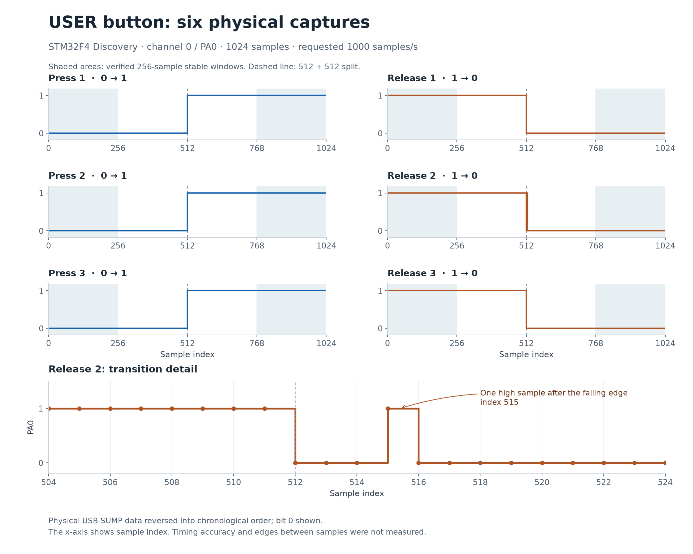

# STM32F4 Discovery USER button test — 24 October 2026

The physical board completed **six captures**: three USER button presses triggered
on rising edges and three releases triggered on falling edges. The normal firmware
with PD0–PD7 inputs and the original GPIO configuration were restored afterwards.
The repeated USB/SUMP test passed **12/12** scenarios.

## Conditions

The signal source was the B1 USER button on PA0. Pressing produces a high level;
releasing produces a low level. The connection is documented in
[UM1472](https://www.st.com/resource/en/user_manual/um1472-stm32f4-discovery-stmicroelectronics.pdf)
and sheet 6 of the
[MB997 B-02 schematic](https://www.st.com/resource/en/schematic_pack/mb997-f407vgt6-b02_schematic.pdf).
No external signal wires were connected. The debugger did not halt the CPU during
capture; commands and samples used USB CDC.

The test used a diagnostic copy of source revision
`e4213765922f5877a4755e51d4a9a1a3d907c7d7`. In this build, DMA reads `GPIOA->IDR`,
PA0 is an input with a pull-down, and EXTI0 is routed to PA0. This adaptation does
not reconfigure other GPIOA pins, including USB. **Only bit 0, PA0, was checked**;
this test does not validate the other channels. The normal project configuration
remains PD0–PD7.

| Parameter | Value |
| --- | --- |
| Board | STM32F4 Discovery, STM32F407 |
| Edge source | Physical B1 USER button |
| Requested sample rate | 1000 samples/s |
| Capture length | 1024 samples |
| Requested post-trigger window | 512 samples |
| Trigger mask | `0x01` |
| Stable windows checked | First and last 256 samples |

SHA-256 checksums of the diagnostic build:

| Artifact | SHA-256 |
| --- | --- |
| ELF | `6c6cf638bdf7b639548b56d57c014bbbc0ef10c15abec2e87cb6b8213e1dcd1f` |
| BIN | `c4bf53ed0c6664b1b6107498f169c5005869d493612a1a5c5b7ce5b326e684b6` |
| Input-configuration patch | `3f51e9ab90703a15cb1dc037bb8381a4e74e72ef1f9991da4201ab0267a8ac30` |

## Results

Before each action, the capture state was confirmed as `ARMED` and no reply was
received before the edge. Each capture returned exactly 1024 bytes with no extra
data afterwards. The first 256 samples matched the initial stable level and the
last 256 matched the new level. Received SUMP bytes were reversed into chronological
order; analysis uses the least significant bit of each byte.

| Action | Chronological groups: level × samples | Result |
| --- | --- | --- |
| Press 1 | `0 × 512 → 1 × 512` | Passed |
| Release 1 | `1 × 512 → 0 × 512` | Passed |
| Press 2 | `0 × 512 → 1 × 512` | Passed |
| Release 2 | `1 × 512 → 0 × 3 → 1 × 1 → 0 × 508` | Passed |
| Press 3 | `0 × 512 → 1 × 512` | Passed |
| Release 3 | `1 × 512 → 0 × 512` | Passed |

The second release contains one additional high sample at index 515 after the
initial falling edge. This sequence is consistent with contact bounce. It did not
produce an extra capture reply. The plot uses the received data directly, without
smoothing or removing transitions.

The horizontal axis is sample index. The requested 1000 samples/s is not an
independent frequency measurement: the duration of the brief return to high was
not established, and additional edges between samples cannot be ruled out. This
test validates triggering and data transfer for both edge directions. Trigger
position accuracy, jitter, and maximum frequency were not measured.

## Restoring the normal configuration

After testing, the normal ELF from build
`51bf62b7d927a4b8163999f41db067e54011478a` was programmed and verified against
Flash. Its SHA-256 is
`f6b4772cd9247245eb38aaaf91af8a363f1b7feb95f60e5e35c3c73278554e9b`.
That build is described in the [main test report](stm32f4-discovery-2026-10-24.md).

Register readback confirmed:

- GPIOA and GPIOD settings (`MODER`, `OTYPER`, `OSPEEDR`, `PUPDR`, `ODR`, `AFRL`,
  `AFRH`) match their values saved before testing.
- `SYSCFG_EXTICR[0..1] = 0x3333, 0x3333`: EXTI0–EXTI7 are routed to GPIOD.
- The DMA peripheral address is `0x40020c10`, which is `GPIOD->IDR`.
- Capture is `IDLE`, the scheduler is running, and `CFSR`/`HFSR` and recorded
  fatal-error fields are zero.

All 12 USB/SUMP scenarios passed after restoration. The debug session was closed
and the normal firmware was left running on the board.

## Evidence

Local test artifacts are `build-info.json`, `button-remap.patch`, six captures
from `01-rising.bin` through `03-falling.bin`, `captures/report.json`,
`restored-registers.json`, and `restored-usb-smoke/report.json`. Lengths, checksums,
and level groups for all six captures were independently checked against the
report when generating the plot. Local paths and board-specific USB identifiers
are omitted from this document.
